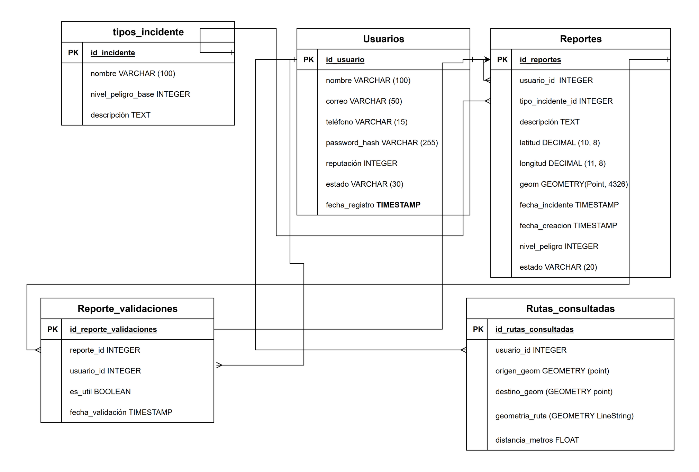
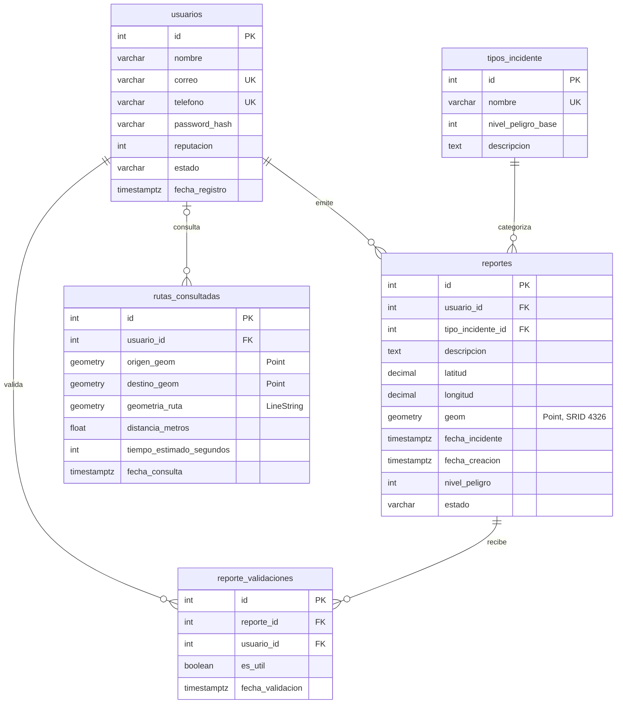

# Diagrama entidad-relación — PINPOINT GPS

> Diagrama original en [`DER.drawio`](DER.drawio) (se abre con [draw.io](https://app.diagrams.net/)).

## Cardinalidades

| Relación | Cardinalidad | Descripción |
|---|---|---|
| `usuarios` → `reportes` | 1 : N | Un usuario emite muchos reportes; cada reporte tiene un único autor. |
| `tipos_incidente` → `reportes` | 1 : N | Un tipo categoriza muchos reportes; cada reporte tiene un tipo. |
| `usuarios` ↔ `reportes` | N : M | Resuelta con `reporte_validaciones`: la comunidad confirma (`es_util = true`) o desmiente un reporte. |
| `usuarios` → `rutas_consultadas` | 0..1 : N | Un usuario consulta muchas rutas; la ruta puede ser anónima (`usuario_id` nulo). |

## Notas de diseño

- La columna `geom` (`GEOMETRY(Point, 4326)`) permite medir distancias reales con PostGIS y se
  complementa con las columnas `latitud` / `longitud` para lectura sencilla desde la API.
- El índice **GiST** (`idx_reportes_geom`) acelera las consultas de proximidad (`ST_DWithin`).
- La restricción `UNIQUE (reporte_id, usuario_id)` evita que un mismo usuario vote dos veces el mismo
  reporte, lo que sostiene el sistema de reputación.
